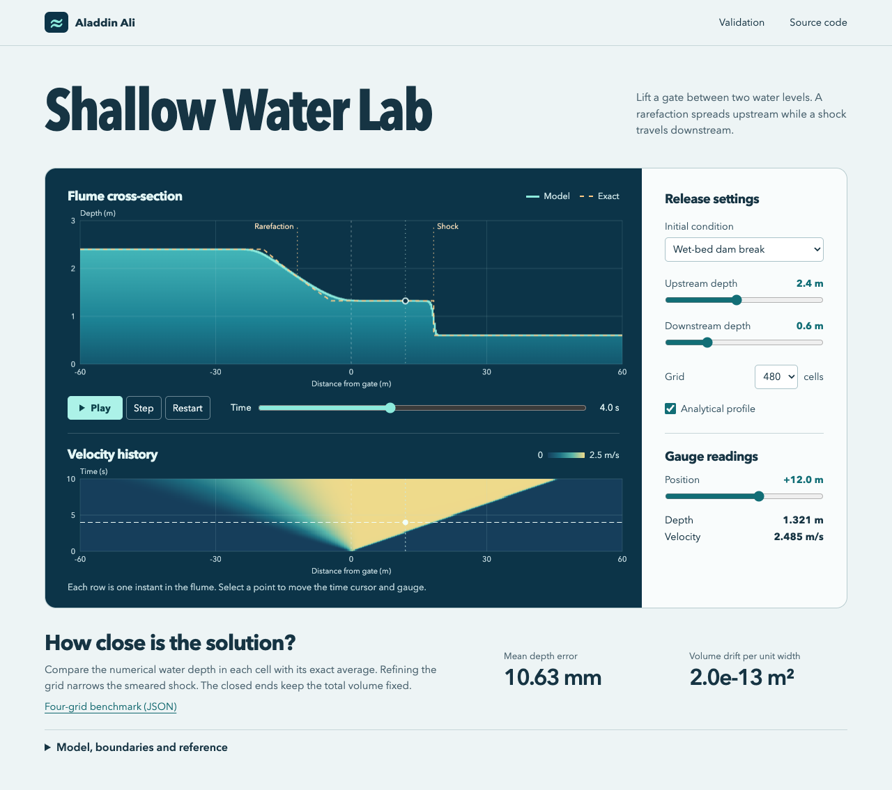

# Shallow Water Lab

Release a gate in a 120 m flume. Water accelerates out of the reservoir, a fan of waves spreads upstream, and a shock enters the shallow pool. Move the gauge across the shock and switch between 120 and 960 cells to see where the numerical model loses detail. [Open the lab](https://naxe.dev/labs/shallow-water/?utm_source=github&utm_medium=readme&utm_campaign=portfolio&utm_content=shallow-water)



The lab opens paused at four seconds. The dashed profile is the analytical solution. Click the velocity map to inspect an earlier or later state, or use the Time and Position sliders with the keyboard. **Step** advances by 0.1 simulated seconds. **Restart** returns the gate to its initial state. The still-water control leaves the entire channel level.

## Validation

For the standard release, the water starts at rest with a 2.4 m reservoir and a 0.6 m downstream pool. At 4 s the analytical shock lies 18.256 m downstream and the water immediately behind it is 1.324 m deep. An independent reference integrates the exact depth across each numerical cell, including cells that straddle the shock.

| Cells | Cell width | Mean absolute depth error | Numerical shock position |
| ---: | ---: | ---: | ---: |
| 120 | 1 m | 28.07 mm | 18.289 m |
| 240 | 0.5 m | 16.60 mm | 18.230 m |
| 480 | 0.25 m | 10.63 mm | 18.205 m |
| 960 | 0.125 m | 6.24 mm | 18.208 m |

The depth error fell on every refinement. The shock position, measured at half the height of the jump by linear interpolation between cell centres, varied by a few centimetres in either direction. Across these four runs, the largest absolute volume drift sampled every 0.1 s was 1.82 × 10⁻¹² m², against an initial volume per unit width of 180 m². [Full benchmark output](web/benchmark.json)

A second test tracks the crest of a smooth wave in a periodic channel. Its sinusoidal depth varies from 0.98 to 1.02 m over 120 m. Setting the initial velocity to $u=2(\sqrt{gh}-\sqrt{g h_0})$ with $h_0=1$ m leaves one Riemann invariant constant. Before steepening produces a shock, the crest moves at $u+\sqrt{gh}$, or 3.22559 m/s. At 4 s a quadratic fit to three numerical cells around the crest gave 3.22530 m/s on the 960-cell grid, a relative error of 0.0090%.

## Run locally

The browser and numerical tests have no package dependencies. Use Node 20 or newer for the CLI. Serve the static web directory with any HTTP server.

```sh
node --test
node scripts/benchmark.mjs
python3 -m http.server 8080 --directory web
```

Open `http://localhost:8080`. Reproduce a gauge experiment or export the full cell profile for analysis.

```sh
node scripts/run.mjs --cells 960 --time 4
node scripts/run.mjs --upstream 1.8 --downstream 0.8 --cells 240 --time 3 --csv > profile.csv
```

The benchmark command writes JSON to stdout. Run `node scripts/benchmark.mjs --check web/benchmark.json` to compare the full run with the receipt. To update the checked-in receipt, use `node scripts/benchmark.mjs --write web/benchmark.json`. Optional browser checks exercise both layouts, playback, keyboard controls, the baseline and plotted probes. With the local server running and Playwright plus Chromium installed, run `node scripts/check-ui.mjs`. Pass `--engine webkit` to exercise WebKit or `--screenshots DIRECTORY` to save both views.

## Solver and limits

The solver evolves cell averages of depth $h$ and discharge per unit width $q=hu$ using the flat-bed Saint-Venant system.

$$
\partial_t h + \partial_x q=0,\qquad
\partial_t q + \partial_x\left(q^2/h + gh^2/2\right)=0.
$$

Each face uses a local Lax–Friedrichs (Rusanov) flux shared by its two neighbours. Forward Euler advances time with $\Delta t \leq 0.45\Delta x/\max(|u|+\sqrt{gh})$. Steps shorten to land on output times. Mirrored discharge at the walls gives exactly zero numerical volume flux. The first-order scheme smears steep gradients, which makes the difference between conserving volume and resolving the front visible in a single run. [Solver implementation](web/lib/solver.mjs)

The analytical module solves one scalar matching equation for the plateau depth, then evaluates the rarefaction, plateau and shock directly from position and time. It shares no update or flux code with the solver. The browser stops at the earlier of 10 s or 82% of the first wave's travel time to a wall, rounded down to a 0.1 s frame. A separate regression runs through reflections to check conservation. [Analytical implementation](web/lib/reference.mjs) · [Physics tests](test/physics.test.mjs)

Both checks compare numerical results with idealized equations. The channel has constant width, a level frictionless bed and positive water depth everywhere. The model averages velocity over the depth and assumes hydrostatic pressure. Dry-bed inundation, turbulence and three-dimensional flow require other models. The comparisons use analytical solutions and have no measured flume data.

## Method credits

The conservation laws, Riemann invariants and shock jump conditions follow Ketcheson, LeVeque and del Razo, *Riemann Problems and Jupyter Solutions*. The numerical solver, exact reference, benchmark, plots and interaction code were implemented for this lab. [Shallow-water derivation](https://www.clawpack.org/riemann_book/html/Shallow_water.html) · [Local Lax–Friedrichs method](https://www.clawpack.org/riemann_book/html/Approximate_solvers.html) · [Notice](NOTICE)
